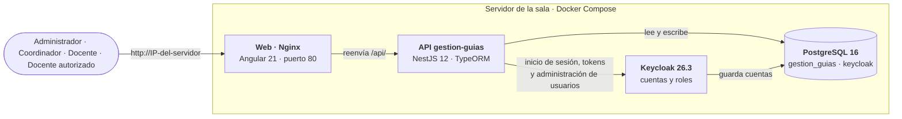

# System Plus · Intranet de guías académicas

Plataforma web para crear, versionar y mejorar las **guías de aprendizaje** del programa académico de System Plus Piendamó.

- La **coordinación** define los módulos, las competencias y las guías base.
- Los **docentes** adaptan las guías en versiones propias y proponen mejoras.
- La **administración** gestiona las cuentas, los roles y la auditoría.

Funciona **sin internet**: se instala en el servidor de la sala de System Plus y los usuarios entran desde computadores, celulares o la pantalla OneScreen.

Desarrollado por el equipo **AthenaDev Developers** para System Plus del Cauca SAS, en el curso Proyecto I de la Universidad del Cauca.

| En cifras | |
|---|---|
| Épicas implementadas | 11 (HE-01 a HE-11) |
| Rutas de la API | 88, de ellas 83 protegidas por rol |
| Tablas en PostgreSQL | 16 |
| Pruebas automatizadas | 658 (285 unitarias y 18 de integración en el backend, 355 en el frontend) |
| Servicios en producción | 4 contenedores de Docker: web, api, keycloak y db |

---

## Contenido

1. [Funcionalidades](#1-funcionalidades)
2. [Arquitectura](#2-arquitectura)
3. [Tecnologías](#3-tecnologías)
4. [Estructura del repositorio](#4-estructura-del-repositorio)
5. [Requisitos](#5-requisitos)
6. [Puesta en marcha rápida (solo frontend)](#6-puesta-en-marcha-rápida-solo-frontend)
7. [Puesta en marcha completa (frontend + backend + Keycloak)](#7-puesta-en-marcha-completa-frontend--backend--keycloak)
8. [Instalación en la sala (producción)](#8-instalación-en-la-sala-producción)
9. [Usuarios de prueba](#9-usuarios-de-prueba)
10. [Pruebas](#10-pruebas)
11. [Flujo de trabajo con Git](#11-flujo-de-trabajo-con-git)
12. [Documentación](#12-documentación)
13. [Equipo](#13-equipo)
14. [Licencia](#14-licencia)

---

## 1. Funcionalidades

El proyecto se organiza en once épicas (HE). Cada una tiene sus historias de usuario (HU) en el backlog del proyecto, y todas están conectadas al backend.

| Épica | Rol | Qué permite | Módulo de la API |
|---|---|---|---|
| **HE-01** Usuarios, roles y permisos | Administrador | Registrar, editar, desactivar y reactivar usuarios; cambiar roles; restablecer contraseñas | `users` (Keycloak) |
| **HE-02** Programa académico | Coordinador Académico | Programa Técnico en Sistemas, sus 7 módulos y sus competencias, con historial de versiones | `academic-program` |
| **HE-03** Guías de aprendizaje | Coordinador Académico | Guías base, estructura de campos, publicación, material de apoyo, asignación de docentes y descarga en Word o PDF | `academic` |
| **HE-04** Espacio docente | Docente / Docente Autorizado | Consultar guías asignadas, crear versiones propias por grupo y descargarlas | `teacher-space` |
| **HE-05** Sugerencias | Docente y Coordinador | Proponer cambios a una guía y aprobarlos o rechazarlos, con plazos y notificaciones ([detalle](docs/he05-sugerencias.md)) | `suggestions` |
| **HE-06** Búsqueda de guías | Todos | Buscar por texto y filtrar por módulo, competencia, estado y autor | `guide-search` |
| **HE-07** Historial de versiones | Coordinador y Docente | Ver las versiones de una guía y compararlas | `guide-history` |
| **HE-08** Auditoría y permisos | Administrador | Historial de acciones de los usuarios y matriz de permisos por rol ([auditoría](docs/he08-auditoria.md), [permisos](docs/he08-permisos-por-rol.md)) | `audit` |
| **HE-09** Configuración del sistema | Coordinador | Tiempo límite de respuesta a sugerencias y periodos de bloqueo de edición | `suggestions`, `academic` |
| **HE-10** Acceso e inicio de sesión | Todos | Contraseña temporal, política de contraseñas, bloqueo por intentos, "mantener sesión" y cierre por inactividad | `auth` (Keycloak) |
| **HE-11** Inicio, navegación y reportes | Todos / Coordinador | Inicio y menú por rol, aviso de privacidad y **Reportes** de guías y sugerencias en pantalla, Excel o PDF | `reports` |

### Backend de HE-03 y HE-04

Las guías, sus formularios y las versiones docentes **se guardan en PostgreSQL** y sobreviven a los reinicios de la API. Todas las rutas están bajo `/academic`.

- **Guía base (HE-03, rol `coordinador`):**
  - Se crea sobre un módulo activo de HE-02 y una de sus competencias. La API genera el título, el código y la versión.
  - Pasa de borrador (`v0`) a publicada (`v1.0`). Una guía publicada ya no se edita.
  - Guarda una copia del módulo, la competencia y los campos del formulario. Así, cambios posteriores en HE-02 o en el formulario no alteran las guías existentes.
  - Registra quién la creó, la editó y la publicó, con su historial de eventos.
  - Admite material de apoyo (un PDF o DOCX por carga, máximo 10 MB) y se descarga en **Word o PDF** con el logo oficial de System Plus. El documento se arma desde el código, sin plantillas, y LibreOffice lo convierte a PDF.
- **Formularios configurables (HE-03):** el coordinador define los campos de la guía base y los de la guía docente por módulo o por competencia: sección, ayuda, longitud máxima y si el docente puede editarlos. Si un módulo no tiene formulario propio, se usan los campos institucionales por defecto.
- **Espacio docente (HE-04, rol `docente`):**
  - El coordinador asigna docentes a cada módulo.
  - El docente ve solo las guías publicadas de sus módulos.
  - Crea su propia copia y la edita por partes, sin modificar nunca la guía base.
  - El **docente autorizado** puede además complementar su versión (por ejemplo, los tipos de archivo de cada competencia), pero el texto base se conserva: la API rechaza cualquier cambio que lo borre o lo altere.
  - También puede descargarla en Word o PDF.

Las rutas completas están en [`gestion-guias/README.md`](gestion-guias/README.md), y hay una colección de Postman en [`gestion-guias/postman/`](gestion-guias/postman/).

## 2. Arquitectura

Una aplicación web (Angular) habla con una API organizada en módulos (NestJS). Keycloak guarda las cuentas y los roles, y PostgreSQL guarda todo lo demás. En producción, las cuatro piezas corren en el mismo servidor con Docker Compose.



**Cómo funciona una petición:**

1. El usuario abre la aplicación y escribe su correo y contraseña en el **formulario propio** de System Plus.
2. La API valida esas credenciales con **Keycloak** y devuelve un **token** que incluye su rol: `admin`, `coordinador`, `docente` o `docente_autorizado`.
3. La aplicación muestra solo las pantallas de ese rol y envía el token en cada petición. **Nginx** la pasa a la API.
4. La API valida la firma del token, comprueba el rol, registra la acción en la auditoría y lee o escribe en **PostgreSQL**. Los usuarios no se guardan en PostgreSQL: la API los administra directamente en Keycloak.

### Diagramas

Los diagramas C4 y de datos están en [`docs/arquitectura/`](docs/arquitectura/), con sus fuentes editables en PlantUML.

| Diagrama | Qué muestra |
|---|---|
| [Contexto](docs/arquitectura/01-contexto.png) | Roles y sistema |
| [Contenedores](docs/arquitectura/02-contenedores.png) | Web, API, Keycloak y base de datos |
| [Componentes de la API](docs/arquitectura/03-componentes-api.png) | Un módulo por épica y sus dependencias |
| [Componentes de la web](docs/arquitectura/04-componentes-web.png) | Rutas, guards, autenticación y adaptadores |
| [Despliegue](docs/arquitectura/05-despliegue.png) | Red de la sala, servidor OPS y contenedores |
| [Modelo de datos](docs/arquitectura/06-modelo-datos.png) | Las 16 tablas y sus relaciones |
| [Clases por módulo](docs/arquitectura/07-clases-modulos.png) | Controladores y servicios de la API |

## 3. Tecnologías

| Capa | Tecnología |
|---|---|
| Frontend | Angular 21, TypeScript, signals, carga diferida por ruta |
| Backend | NestJS 12, TypeScript, TypeORM, validación con `class-validator` |
| Base de datos | PostgreSQL 16, con migraciones de TypeORM |
| Autenticación | Keycloak 26.3 (OpenID Connect, tokens JWT), con formulario propio a través de la API |
| Pruebas | Vitest y Supertest (frontend y backend) |
| Servidor web | Nginx, con encabezados de seguridad |
| Despliegue | Docker Compose; paquete sin internet generado con GitHub Actions |
| Gestor de paquetes | pnpm (frontend y backend) |

## 4. Estructura del repositorio

```
system-plus-project/
├── frontend/          Aplicación web en Angular (la usan los cuatro roles)
│   ├── src/app/core/      Autenticación, guards, interceptor y layout
│   ├── src/app/features/  Una carpeta por épica: users, academic-program, guides,
│   │                      teacher-space, suggestions, audit, settings, home, auth, legal
│   ├── src/app/shared/    Modelos, utilidades y componentes reutilizables
│   └── GUIA-EJECUCION.md  Guía detallada del frontend
├── gestion-guias/     API REST en NestJS
│   ├── src/auth/              Inicio de sesión, validación de tokens y roles
│   ├── src/users/             HE-01 · puente hacia la administración de Keycloak
│   ├── src/academic-program/  HE-02 · programa, módulos y competencias
│   ├── src/academic/          HE-03 · guías, formularios, versiones y exportación
│   ├── src/teacher-space/     HE-04 · espacio docente
│   ├── src/suggestions/       HE-05 y HE-09 · sugerencias, notificaciones y plazos
│   ├── src/guide-search/      HE-06 · búsqueda de guías
│   ├── src/guide-history/     HE-07 · historial de versiones
│   ├── src/audit/             HE-08 · auditoría y permisos por rol
│   ├── src/database/          Conexión y migraciones
│   ├── postman/               Colección de Postman para probar la API
│   └── .env.example           Plantilla de configuración
├── keycloak/          Realm "system-plus" de desarrollo y de producción
├── deploy/            Nginx, scripts de instalación, respaldo y datos de demostración
├── docs/              Documentación técnica, diagramas y guía de instalación de la sala
├── .github/workflows/ Generación del paquete de instalación sin internet
└── docker-compose.yml Los cuatro servicios de producción
```

**Puertos en desarrollo**

| Servicio | Dirección |
|---|---|
| Frontend | http://localhost:4200 |
| Backend (API) | http://localhost:3000 |
| Keycloak | http://localhost:8080 (consola de administración en `/admin`) |
| PostgreSQL | `localhost:5432` |

## 5. Requisitos

| Herramienta | Versión | Para qué | Comprobar |
|---|---|---|---|
| Git | Reciente | Clonar el repositorio | `git --version` |
| Node.js | 22 LTS o 24 | Frontend y backend | `node -v` |
| pnpm | 12 (se instala con `npm install -g pnpm`) | Frontend y backend | `pnpm -v` |
| PostgreSQL | 15 o superior | Base de datos del backend | `psql --version` |
| Keycloak | 26.3 | Inicio de sesión | Con Docker o con Java 21 (ver sección 7.1) |
| LibreOffice | Reciente | Solo para descargar guías en PDF | `soffice --version` |

Para trabajar **solo en el frontend con datos simulados** basta con Git, Node.js y pnpm.

## 6. Puesta en marcha rápida (solo frontend)

Este modo no necesita backend ni Keycloak. Sirve para revisar pantallas o trabajar en la interfaz.

1. Instala las dependencias:

   ```powershell
   cd frontend
   pnpm install --frozen-lockfile
   ```

2. En `frontend/src/environments/environment.ts` cambia `auth`, `api` y `apiAcademico` a `'mock'`:

   ```ts
   auth: 'mock' as 'api' | 'keycloak' | 'mock',
   api: 'mock' as 'http' | 'mock',
   apiAcademico: 'mock' as 'http' | 'mock',
   ```

   > **Importante:** este cambio es solo para tu computador. El archivo del repositorio debe seguir con `'api'` y `'http'`, porque es la configuración que usa el resto del equipo. Si haces este cambio, no lo incluyas en tus commits: en GitHub Desktop, haz clic derecho sobre `environment.ts` y elige *Discard changes* antes de hacer commit.

3. Arranca el servidor:

   ```powershell
   pnpm start
   ```

4. Abre http://localhost:4200 y entra con un usuario simulado (sección 9).

Para detener el servidor, pulsa `Ctrl + C` en la terminal.

## 7. Puesta en marcha completa (frontend + backend + Keycloak)

Para obtener el código basta con la rama estable, no hace falta bajar las demás:

```bash
git clone https://github.com/zailynidrobo/system-plus-project.git
cd system-plus-project
```

Hay que encender cuatro servicios **en este orden**. Usa una terminal distinta para cada uno.

### 7.1 Keycloak

Keycloak se puede correr de dos formas:

- **Con Docker.** Es la forma que usa el equipo.
- **Sin Docker, con Java 21.** Es más liviana y conviene en equipos con poca memoria RAM.

En ambos casos se importa el realm `system-plus`, que ya trae los roles, los clientes y los usuarios de prueba. La instalación de la sala usa otro archivo, `keycloak/system-plus-realm.produccion.json`, sin usuarios de prueba (ver [la guía de instalación](docs/intranet/guia-instalacion-sala.md)). Los comandos y las credenciales de la consola de administración están en [`keycloak/README.md`](keycloak/README.md).

### 7.2 PostgreSQL

Con Docker (en Git Bash):

```bash
docker run --name pg-guias -e POSTGRES_PASSWORD=postgres -e POSTGRES_DB=gestion_guias -p 5432:5432 -d postgres:16
```

Si ya tienes un PostgreSQL instalado, solo crea una base de datos vacía llamada `gestion_guias`. Las tablas se crean solas cuando arranca el backend (con `DB_SYNCHRONIZE=true`), y la primera vez se carga el programa **Técnico en Sistemas** con sus 7 módulos reales y sus competencias. En producción no se usa `DB_SYNCHRONIZE`: el esquema se crea con migraciones.

```sql
CREATE DATABASE gestion_guias;
```

### 7.3 Backend

```powershell
cd gestion-guias
copy .env.example .env
```

Abre `.env` y completa:

- `DB_USER` y `DB_PASSWORD` con los de tu PostgreSQL.
- `KEYCLOAK_ADMIN_CLIENT_SECRET` con el secreto de desarrollo indicado en [`keycloak/README.md`](keycloak/README.md).
- `LIBREOFFICE_PATH`, solo si LibreOffice no está en el PATH. En Windows apunta a `soffice.com`; por ejemplo, `C:\Program Files\LibreOffice\program\soffice.com`.

`.env` nunca se sube al repositorio (está en `.gitignore`).

Instala y arranca:

```powershell
pnpm install --frozen-lockfile
pnpm start:dev
```

La API queda en http://localhost:3000. Los endpoints están documentados en [`gestion-guias/README.md`](gestion-guias/README.md).

### 7.4 Frontend

Con `environment.ts` tal como está en el repositorio (`auth: 'api'`, `api` y `apiAcademico` en `'http'`):

```powershell
cd frontend
pnpm install --frozen-lockfile
pnpm start
```

Abre http://localhost:4200 y entra en el formulario de inicio de sesión con un usuario de Keycloak (sección 9).

## 8. Instalación en la sala (producción)

En producción todo corre con Docker Compose en el módulo OPS de la pantalla de la sala, sin necesitar internet.

1. Al publicar en la rama `paquete-sala`, GitHub Actions construye las cuatro imágenes y las sube a *Releases* como un paquete comprimido.
2. En la sala se copia el paquete con una memoria USB y se ejecuta `deploy/scripts/instalar-servidor.ps1`, que carga las imágenes y levanta los servicios.
3. Los usuarios entran desde la red local a `http://IP-del-servidor`. Solo queda abierto el puerto 80.
4. `deploy/scripts/respaldo-bd.ps1` hace la copia de seguridad diaria de las dos bases y conserva las últimas 14.

El paso a paso, la configuración del router y la solución de problemas están en la [guía de instalación de la sala](docs/intranet/guia-instalacion-sala.md).

## 9. Usuarios de prueba

Hay un usuario de prueba por cada rol:

| Rol | Usuario |
|---|---|
| Administrador | `admin@example.com` |
| Coordinador Académico | `coordinador@example.com` |
| Docente | `docente@example.com` |
| Docente Autorizado | `autorizado@example.com` |

Las contraseñas dependen del modo:

- **Puesta en marcha completa:** las contraseñas de Keycloak están en [`keycloak/README.md`](keycloak/README.md).
- **Modo simulado:** las contraseñas están en [`frontend/GUIA-EJECUCION.md`](frontend/GUIA-EJECUCION.md), sección 6. Ese modo tiene además un usuario desactivado para probar el bloqueo de acceso.

> Estos usuarios existen solo en desarrollo. Nunca subas al repositorio contraseñas, secretos ni el archivo `.env` de un entorno real.

## 10. Pruebas

```powershell
# Frontend
cd frontend
pnpm exec ng test --watch=false

# Backend
cd gestion-guias
pnpm test            # unitarias
pnpm test:e2e        # de integración; requieren .env.test con una base terminada en _test
pnpm lint            # revisión de estilo
```

Antes de abrir un pull request, las pruebas y el lint deben pasar.

| Suite | Cantidad |
|---|---|
| Backend, unitarias | 285 |
| Backend, integración (e2e) | 18 |
| Frontend | 355 |

## 11. Flujo de trabajo con Git

El equipo usa un **Git Flow simplificado**. El detalle está en [`docs/branching-strategy.md`](docs/branching-strategy.md).

| Rama | Uso |
|---|---|
| `main` | Producción. Solo código estable. |
| `develop` | Integración. **Toda rama nueva nace de aquí.** |
| `feature/<JIRA-ID>-<descripcion>` | Nuevas funcionalidades. Ejemplo: `feature/HE-01-usuarios-http` |
| `fix/<JIRA-ID>-<descripcion>` | Correcciones |

**Pasos para aportar:**

1. Actualiza `develop` (en GitHub Desktop: *Fetch origin* → *Pull origin*).
2. Crea tu rama desde `develop` con el nombre de la tarea de Jira.
3. Haz commits pequeños con [Conventional Commits](https://www.conventionalcommits.org/es/):
   - `feat:` nueva funcionalidad;
   - `fix:` corrección;
   - `docs:` documentación;
   - `test:` pruebas;
   - `chore:` mantenimiento.
4. Abre un pull request hacia `develop`. Necesita al menos una aprobación.

Nunca se hace push directo a `main` ni a `develop`.

## 12. Documentación

| Documento | Contenido |
|---|---|
| [`docs/branching-strategy.md`](docs/branching-strategy.md) | Estrategia de ramas y convenciones |
| [`docs/arquitectura/`](docs/arquitectura/) | Diagramas C4, despliegue, modelo de datos y clases, con fuentes en PlantUML |
| [`docs/intranet/guia-instalacion-sala.md`](docs/intranet/guia-instalacion-sala.md) | Instalación en la sala sin internet, red y respaldos |
| [`docs/he05-sugerencias.md`](docs/he05-sugerencias.md) | Flujo de sugerencias, plazos y notificaciones |
| [`docs/he08-auditoria.md`](docs/he08-auditoria.md) | Auditoría de acciones |
| [`docs/he08-permisos-por-rol.md`](docs/he08-permisos-por-rol.md) | Matriz de permisos por rol |
| [`docs/verificacion-front-HE01-HE05.md`](docs/verificacion-front-HE01-HE05.md) | Estado de cada HU en el frontend y pendientes de integración |
| [`frontend/GUIA-EJECUCION.md`](frontend/GUIA-EJECUCION.md) | Guía detallada del frontend: rutas, recorrido de prueba y problemas comunes |
| [`gestion-guias/README.md`](gestion-guias/README.md) | Configuración y endpoints del backend |
| [`keycloak/README.md`](keycloak/README.md) | Realms de desarrollo y producción, y cómo importarlos |

## 13. Equipo

**AthenaDev Developers**

| Integrante | Rol | GitHub |
|---|---|---|
| Yasley Mayerly Camilo Camilo | Product Owner y desarrollo | [@yasmcamilo](https://github.com/yasmcamilo) |
| Zailyn Estefany Idrobo Rodríguez | Scrum Master, análisis y QA | [@zailynidrobo](https://github.com/zailynidrobo) |
| Cristhian Daniel Torres Meneses | Backend y Docker | [@CristhianTorresM](https://github.com/CristhianTorresM) |
| Juliana Andrea Díaz Cárdenas | Frontend | [@juliaaa2](https://github.com/juliaaa2) |
| Sofía Moreno Trullo | Full stack | [@SofiaMorenoT](https://github.com/SofiaMorenoT) |

**Cliente:** System Plus Piendamó (System Plus del Cauca SAS).
**Gerente del proyecto:** PhD. Miguel Ángel Niño Zambrano · Proyecto I, Universidad del Cauca.

## 14. Licencia

Distribuido bajo la licencia MIT. Ver [`LICENSE`](LICENSE).