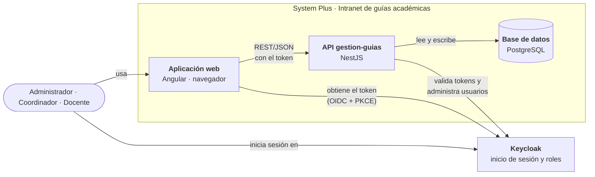

# System Plus · Intranet de guías académicas

Plataforma web para crear, versionar y mejorar las **guías de aprendizaje** del programa académico de System Plus Piendamó.

- La **coordinación** define los módulos, las competencias y las guías base.
- Los **docentes** adaptan las guías en versiones propias y proponen mejoras.
- La **administración** gestiona las cuentas y los roles.

Desarrollado por el equipo **AthenaDev**.

---

## Contenido

1. [Funcionalidades](#1-funcionalidades)
2. [Arquitectura](#2-arquitectura)
3. [Tecnologías](#3-tecnologías)
4. [Estructura del repositorio](#4-estructura-del-repositorio)
5. [Requisitos](#5-requisitos)
6. [Puesta en marcha rápida (solo frontend)](#6-puesta-en-marcha-rápida-solo-frontend)
7. [Puesta en marcha completa (frontend + backend + Keycloak)](#7-puesta-en-marcha-completa-frontend--backend--keycloak)
8. [Usuarios de prueba](#8-usuarios-de-prueba)
9. [Pruebas](#9-pruebas)
10. [Flujo de trabajo con Git](#10-flujo-de-trabajo-con-git)
11. [Documentación](#11-documentación)
12. [Equipo](#12-equipo)
13. [Licencia](#13-licencia)

---

## 1. Funcionalidades

El proyecto se organiza en cinco épicas (HE). Cada una tiene sus historias de usuario (HU) en Jira.

| Épica | Rol | Qué permite | Frontend | Backend |
|---|---|---|---|---|
| **HE-01** Usuarios, roles y permisos | Administrador | Registrar, editar y desactivar usuarios; asignar roles | Conectado al backend | Keycloak |
| **HE-02** Programa académico | Coordinador Académico | Módulos curriculares y competencias, con historial de versiones | Conectado al backend | PostgreSQL |
| **HE-03** Guías de aprendizaje | Coordinador Académico | Guías base, estructura de campos, publicación, material de apoyo y descarga en Word o PDF | Conectado al backend | PostgreSQL |
| **HE-04** Espacio docente | Docente / Docente Autorizado | Consultar guías asignadas y crear versiones propias | Con datos simulados | PostgreSQL |
| **HE-05** Sugerencias | Docente y Coordinador | Proponer cambios a una guía y aprobarlos o rechazarlos | Con datos simulados | Pendiente |

«Con datos simulados» significa que la pantalla funciona completa, pero con datos de prueba en memoria que se pierden al recargar la página. El detalle de cada HU del frontend está en [`docs/verificacion-front-HE01-HE05.md`](docs/verificacion-front-HE01-HE05.md).

### Backend de HE-03 y HE-04

Las guías, sus formularios y las versiones docentes **se guardan en PostgreSQL** y sobreviven a los reinicios de la API. Todas las rutas están bajo `/academic`.

- **Guía base (HE-03, rol `coordinador`):**
  - Se crea sobre un módulo activo de HE-02 y una de sus competencias. La API genera el título, el código y la versión.
  - Pasa de borrador (`v0`) a publicada (`v1.0`). Una guía publicada ya no se edita.
  - Guarda una copia del módulo, la competencia y los campos del formulario. Así, cambios posteriores en HE-02 o en el formulario no alteran las guías existentes.
  - Registra quién la creó, la editó y la publicó, con su historial de eventos.
  - Admite material de apoyo (un PDF o DOCX por carga, máximo 10 MB) y se descarga en **Word o PDF** con las plantillas institucionales.
- **Formularios configurables (HE-03):** el coordinador define los campos de la guía base y los de la guía docente por módulo o por competencia: sección, ayuda, longitud máxima y si el docente puede editarlos. Si un módulo no tiene formulario propio, se usan los campos institucionales por defecto.
- **Espacio docente (HE-04, rol `docente`):**
  - El coordinador asigna docentes a cada módulo.
  - El docente ve solo las guías publicadas de sus módulos.
  - Crea su propia copia y la edita por partes, sin modificar nunca la guía base.
  - También puede descargarla en Word o PDF.

Las rutas completas están en [`gestion-guias/README.md`](gestion-guias/README.md), y hay una colección de Postman en [`gestion-guias/postman/`](gestion-guias/postman/).

## 2. Arquitectura

El sistema tiene tres piezas propias y un proveedor de identidad externo:



**Cómo funciona una petición:**

1. El usuario abre la aplicación web. Si no tiene sesión, la app lo envía a la pantalla de inicio de sesión de **Keycloak**.
2. Keycloak verifica sus credenciales y devuelve un **token** que incluye su rol: `admin`, `coordinador`, `docente` o `docente_autorizado`.
3. La aplicación muestra solo las pantallas de ese rol y envía el token en cada petición a la **API**.
4. La API valida el token con Keycloak, comprueba el rol y lee o escribe en **PostgreSQL**. Los usuarios no se guardan en PostgreSQL: la API los administra directamente en Keycloak.

## 3. Tecnologías

| Capa | Tecnología |
|---|---|
| Frontend | Angular 21, TypeScript, signals, carga diferida por ruta |
| Backend | NestJS 12, TypeScript, TypeORM, validación con `class-validator` |
| Base de datos | PostgreSQL |
| Autenticación | Keycloak 26 (OpenID Connect, Authorization Code + PKCE, tokens JWT) |
| Pruebas | Vitest (frontend y backend) |
| Gestor de paquetes | pnpm (frontend y backend) |

## 4. Estructura del repositorio

```
system-plus-project/
├── frontend/          Aplicación web en Angular (la usan los tres roles)
│   ├── src/app/core/      Autenticación, guards, interceptor, layout y datos simulados
│   ├── src/app/features/  Una carpeta por épica: users, academic-program, guides,
│   │                      teacher-space, suggestions
│   ├── src/app/shared/    Modelos, utilidades y componentes reutilizables
│   └── GUIA-EJECUCION.md  Guía detallada del frontend
├── gestion-guias/     API REST en NestJS
│   ├── src/users/             HE-01 · puente hacia la administración de Keycloak
│   ├── src/academic-program/  HE-02 · programas, módulos y competencias
│   ├── src/academic/          HE-03 y HE-04 · guías, formularios, versiones docentes y exportación
│   ├── postman/               Colección de Postman para probar la API
│   ├── src/auth/              Validación de tokens y roles de Keycloak
│   └── .env.example           Plantilla de configuración
├── keycloak/          Realm "system-plus" listo para importar en desarrollo
└── docs/              Estrategia de ramas y verificación del frontend
```

**Puertos en desarrollo**

| Servicio | Dirección |
|---|---|
| Frontend | http://localhost:4200 |
| Backend (API) | http://localhost:3000 |
| Keycloak | http://localhost:8080 (consola de administración en `/admin`) |
| PostgreSQL | `localhost:5432` |

## 5. Requisitos

| Herramienta | Versión | Para qué | Comprobar |
|---|---|---|---|
| Git | Reciente | Clonar el repositorio | `git --version` |
| Node.js | 22 LTS o 24 | Frontend y backend | `node -v` |
| pnpm | 12 (se instala con `npm install -g pnpm`) | Frontend y backend | `pnpm -v` |
| PostgreSQL | 15 o superior | Base de datos del backend | `psql --version` |
| Keycloak | 26.3 | Inicio de sesión | Con Docker o con Java 21 (ver sección 7.1) |
| LibreOffice | Reciente | Solo para descargar guías en PDF | `soffice --version` |

Para trabajar **solo en el frontend con datos simulados** basta con Git, Node.js y pnpm.

## 6. Puesta en marcha rápida (solo frontend)

Este modo no necesita backend ni Keycloak. Sirve para revisar pantallas o trabajar en la interfaz.

1. Instala las dependencias:

   ```powershell
   cd frontend
   pnpm install --frozen-lockfile
   ```

2. En `frontend/src/environments/environment.ts` cambia `auth`, `api` y `apiAcademico` a `'mock'`:

   ```ts
   auth: 'mock' as 'keycloak' | 'mock',
   api: 'mock' as 'http' | 'mock',
   apiAcademico: 'mock' as 'http' | 'mock',
   ```

   > **Importante:** este cambio es solo para tu computador. El archivo del repositorio debe seguir con `'keycloak'` y `'http'`, porque es la configuración que usa el resto del equipo. Si haces este cambio, no lo incluyas en tus commits: en GitHub Desktop, haz clic derecho sobre `environment.ts` y elige *Discard changes* antes de hacer commit.

3. Arranca el servidor:

   ```powershell
   pnpm start
   ```

4. Abre http://localhost:4200 y entra con un usuario simulado (sección 8).

Para detener el servidor, pulsa `Ctrl + C` en la terminal.

## 7. Puesta en marcha completa (frontend + backend + Keycloak)

Hay que encender cuatro servicios **en este orden**. Usa una terminal distinta para cada uno.

### 7.1 Keycloak

Keycloak se puede correr de dos formas:

- **Con Docker.** Es la forma que usa el equipo.
- **Sin Docker, con Java 21.** Es más liviana y conviene en equipos con poca memoria RAM.

En ambos casos se importa el realm `system-plus`, que ya trae los roles, los clientes y los usuarios de prueba. Los comandos y las credenciales de la consola de administración están en [`keycloak/README.md`](keycloak/README.md).

### 7.2 PostgreSQL

Crea una base de datos vacía llamada `gestion_guias`. Las tablas se crean solas cuando arranca el backend (con `DB_SYNCHRONIZE=true`), y la primera vez se carga el programa **Técnico en Sistemas** con sus módulos y competencias de ejemplo.

```sql
CREATE DATABASE gestion_guias;
```

### 7.3 Backend

```powershell
cd gestion-guias
copy .env.example .env
```

Abre `.env` y completa:

- `DB_USER` y `DB_PASSWORD` con los de tu PostgreSQL.
- `KEYCLOAK_ADMIN_CLIENT_SECRET` con el secreto de desarrollo indicado en [`keycloak/README.md`](keycloak/README.md).
- `LIBREOFFICE_PATH`, solo si LibreOffice no está en el PATH. En Windows apunta a `soffice.com`; por ejemplo, `C:\Program Files\LibreOffice\program\soffice.com`.

`.env` nunca se sube al repositorio (está en `.gitignore`).

Instala y arranca:

```powershell
pnpm install --frozen-lockfile
pnpm start:dev
```

La API queda en http://localhost:3000. Los endpoints están documentados en [`gestion-guias/README.md`](gestion-guias/README.md).

### 7.4 Frontend

Con `environment.ts` tal como está en el repositorio (`auth: 'keycloak'`, `api` y `apiAcademico` en `'http'`):

```powershell
cd frontend
pnpm install --frozen-lockfile
pnpm start
```

Abre http://localhost:4200. La aplicación te lleva a la pantalla de inicio de sesión de Keycloak. Entra con un usuario de Keycloak (sección 8).

## 8. Usuarios de prueba

Hay un usuario de prueba por cada rol:

| Rol | Usuario |
|---|---|
| Administrador | `admin@example.com` |
| Coordinador Académico | `coordinador@example.com` |
| Docente | `docente@example.com` |
| Docente Autorizado | `autorizado@example.com` |

Las contraseñas dependen del modo:

- **Puesta en marcha completa:** las contraseñas de Keycloak están en [`keycloak/README.md`](keycloak/README.md).
- **Modo simulado:** las contraseñas están en [`frontend/GUIA-EJECUCION.md`](frontend/GUIA-EJECUCION.md), sección 6. Ese modo tiene además un usuario desactivado para probar el bloqueo de acceso.

> Estos usuarios existen solo en desarrollo. Nunca subas al repositorio contraseñas, secretos ni el archivo `.env` de un entorno real.

## 9. Pruebas

```powershell
# Frontend
cd frontend
pnpm exec ng test --watch=false

# Backend
cd gestion-guias
pnpm test            # unitarias
pnpm test:e2e        # de integración; requieren .env.test con una base terminada en _test
pnpm lint            # revisión de estilo
```

Antes de abrir un pull request, las pruebas y el lint deben pasar.

## 10. Flujo de trabajo con Git

El equipo usa un **Git Flow simplificado**. El detalle está en [`docs/branching-strategy.md`](docs/branching-strategy.md).

| Rama | Uso |
|---|---|
| `main` | Producción. Solo código estable. |
| `develop` | Integración. **Toda rama nueva nace de aquí.** |
| `feature/<JIRA-ID>-<descripcion>` | Nuevas funcionalidades. Ejemplo: `feature/HE-01-usuarios-http` |
| `fix/<JIRA-ID>-<descripcion>` | Correcciones |

**Pasos para aportar:**

1. Actualiza `develop` (en GitHub Desktop: *Fetch origin* → *Pull origin*).
2. Crea tu rama desde `develop` con el nombre de la tarea de Jira.
3. Haz commits pequeños con [Conventional Commits](https://www.conventionalcommits.org/es/):
   - `feat:` nueva funcionalidad;
   - `fix:` corrección;
   - `docs:` documentación;
   - `test:` pruebas;
   - `chore:` mantenimiento.
4. Abre un pull request hacia `develop`. Necesita al menos una aprobación.

Nunca se hace push directo a `main` ni a `develop`.

## 11. Documentación

| Documento | Contenido |
|---|---|
| [`docs/branching-strategy.md`](docs/branching-strategy.md) | Estrategia de ramas y convenciones |
| [`docs/verificacion-front-HE01-HE05.md`](docs/verificacion-front-HE01-HE05.md) | Estado de cada HU en el frontend y pendientes de integración |
| [`frontend/GUIA-EJECUCION.md`](frontend/GUIA-EJECUCION.md) | Guía detallada del frontend: rutas, recorrido de prueba y problemas comunes |
| [`gestion-guias/README.md`](gestion-guias/README.md) | Configuración y endpoints del backend |
| [`keycloak/README.md`](keycloak/README.md) | Realm de desarrollo y cómo importarlo |

## 12. Equipo

**AthenaDev**

| Integrante | GitHub |
|---|---|
| Zailyn Idrobo | [@zailynidrobo](https://github.com/zailynidrobo) |
| Julia Díaz | [@juliaaa2](https://github.com/juliaaa2) |
| Sofía Moreno | [@SofiaMorenoT](https://github.com/SofiaMorenoT) |
| Cristhian Torres | [@CristhianTorresM](https://github.com/CristhianTorresM) |
| Yasley Camilo | [@yasmcamilo](https://github.com/yasmcamilo) |

## 13. Licencia

Distribuido bajo la licencia MIT. Ver [`LICENSE`](LICENSE).